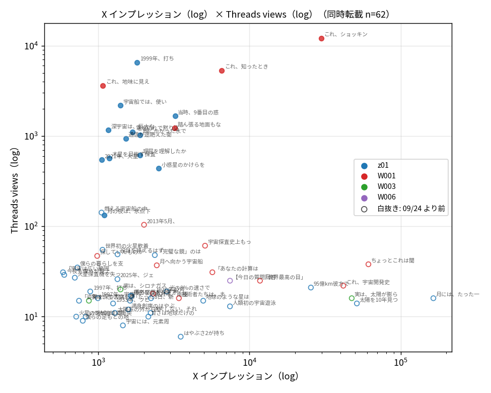
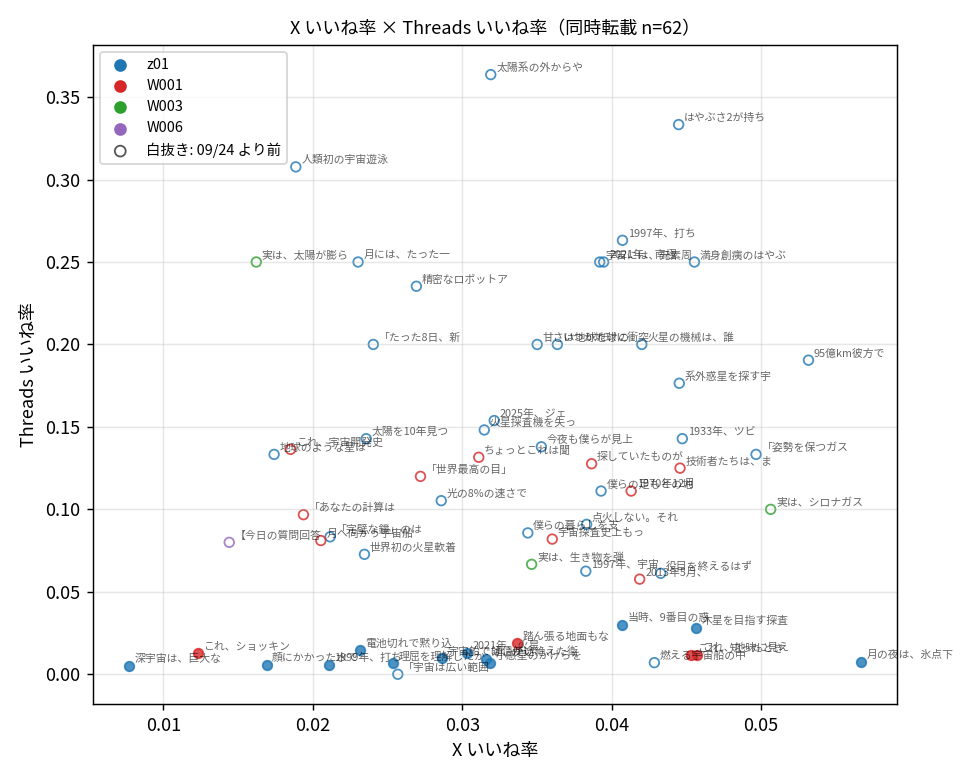

← [変更ログへ](../changelog/)

## 背景・動機

2026-07-21 から cron の X 投稿は同じ本文・画像を Threads にも自動転載している。よーんの問い：**X で反応が良かった投稿は Threads でも反応が良いのか**。相関が強ければ Threads の成果は X の成果で代用して見られ、弱ければ 2 つの媒体は別の読者で、Threads で伸びる型を別に探す価値がある。

## 結論

1. **全期間では相関なし**（同時転載 62 件、インプ × views の Spearman ρ ＝ 0.04）。ただしこれは「相関が無い」のではなく、**9/24 より前は Threads 側に配信がほぼ無かった**ため（投稿あたり views の中央値 18、フォロワー 44 人）。views 6〜140 の範囲は雑音で、X 側の 10 倍の開きと対応しようがない。
2. **9/24 以降は中くらいの正の相関が見える**が、n ＝ 16 で確定できない。インプ × views ρ ＝ 0.43（p ＝ 0.10、log Pearson r ＝ 0.62）、リプライ ρ ＝ 0.62（p ＝ 0.01）、エンゲ率 ρ ＝ 0.49（p ＝ 0.05）、z01 だけのいいね率 ρ ＝ 0.64（p ＝ 0.03）。ρ ＝ 0.43 を p ＜ 0.05 で確かめるには約 40 ペア要る。今の投稿頻度（週 4〜5 本）なら 11 月末ごろに判定できる。
3. **9/24 を境に Threads の到達が別物になった。** views ÷ X インプの中央値は 0.01 → 0.53。Threads フォロワーは 9/26 の 45 人から 10/12 に 126 人へ増え、投稿あたり views は数百〜数千になった。一方で反応率は下がった（いいね率 13% → 1%。views が少なかった頃は見た人のほぼ全員が知人だった）。
4. 運用への含意：**今は Threads を X で代用して評価できない**（データが足りない）。転載は続け、11 月末に同じスクリプトで再計算する。それまで Threads で相対的に伸びた投稿（下記）を参考に見る程度にする。

## データと方法

- 結合：`outputs` シートの Threads 行（B permalink、H x_url）で X ⇄ Threads を対応付け、`X投稿一覧`（K インプ、L いいね、M リポスト、N リプライ、O ブクマ）と `Threads投稿一覧`（I views、J いいね、K リプライ、L リポスト、M 引用、N シェア。G 親投稿URL が空の本体のみ）から値を取る。結合できたペア 144（同時転載 67、後日転載 77）
- 同時転載 ＝ X 投稿から 1 日以内の Threads 投稿。1 つの X 投稿に複数の Threads 行があれば時間差が最小の行
- 使用条件：X 投稿後 9 日以上（X の指標は投稿後 8 日で更新が止まるため）、インプ ＞ 0、views ＞ 0 → 同時転載 62 件（z01 44、W001 14、W003 3、W006 1）。Threads 側は 10/25 取得時点の累積
- 相関は Spearman の順位相関 ρ（順位に置き換えて取る相関。外れ値に強い）を主に、log10 値の Pearson r を添える。量は log10、率はそのまま
- 期間の境目 9/24 は週次の views 中央値から決めた（9/14 週 14 → 9/21 週 133（9/22・23 は 16・17、9/24 から 437〜）→ 9/28 週 984）
- 後日転載 77 件（過去の X 投稿を中央値 106 日後に転載）は、X で伸びた投稿を選んで転載した偏りがあるので参考欄に留めた
- スクリプト：`scripts/x_threads_corr.py`（X API は呼ばない。出力は `outputs/reports/x_threads_corr/` の pairs.csv・corr.md・散布図 3 枚）

## 相関表（Spearman ρ / p / log Pearson r）

| 指標 | 全体（同時転載） | 09/24 以降 | 09/24 以降 z01 | 09/24 より前 | 参考：後日転載 |
|---|---|---|---|---|---|
| インプ vs views（log10） | n=62 ρ=0.04 p=0.745 r=-0.02 | n=16 ρ=0.43 p=0.099 r=0.62 | n=12 ρ=0.28 p=0.378 r=0.33 | n=46 ρ=0.02 p=0.871 r=-0.03 | n=77 ρ=0.32 p=0.004 r=0.35 |
| いいね vs いいね（log10） | n=62 ρ=0.06 p=0.643 r=0.13 | n=16 ρ=0.46 p=0.070 r=0.59 | n=12 ρ=-0.02 p=0.961 r=0.17 | n=46 ρ=0.16 p=0.290 r=0.28 | n=77 ρ=0.53 p=0.000 r=0.51 |
| リプライ vs リプライ | n=62 ρ=0.39 p=0.001 r=0.33 | n=16 ρ=0.62 p=0.011 r=0.57 | n=12 ρ=-0.15 p=0.650 r=-0.14 | n=46 ρ=0.32 p=0.032 r=0.23 | n=77 ρ=0.33 p=0.003 r=0.16 |
| リポスト vs リポスト＋引用 | n=62 ρ=0.13 p=0.329 r=0.02 | n=16 ρ=0.37 p=0.164 r=0.86 | n=12 ρ=0.03 p=0.920 r=-0.10 | n=46 ρ=0.05 p=0.730 r=-0.08 | n=77 ρ=0.44 p=0.000 r=0.13 |
| エンゲ率 vs エンゲ率 | n=62 ρ=0.10 p=0.446 r=0.06 | n=16 ρ=0.49 p=0.052 r=0.46 | n=12 ρ=0.63 p=0.028 r=0.55 | n=46 ρ=-0.02 p=0.905 r=-0.03 | n=77 ρ=0.06 p=0.591 r=-0.01 |
| いいね率 vs いいね率 | n=62 ρ=0.13 p=0.322 r=0.10 | n=16 ρ=0.46 p=0.072 r=0.40 | n=12 ρ=0.64 p=0.026 r=0.50 | n=46 ρ=0.05 p=0.723 r=0.03 | n=77 ρ=0.15 p=0.184 r=0.08 |
| 直前 8 週中央値との比（log2） | n=52 ρ=-0.25 p=0.074 r=-0.23 | n=16 ρ=0.30 p=0.259 r=0.39 | n=12 ρ=0.27 p=0.391 r=0.28 | n=36 ρ=-0.10 p=0.544 r=0.01 | n=52 ρ=0.04 p=0.770 r=0.10 |

全体の「リプライ vs リプライ」が有意（ρ ＝ 0.39）なのは、両媒体ともリプライ 0 の投稿が大半で、少数のリプライが付いた投稿が一致しているため。量の相関としては読まない。

白抜きが 9/24 より前。下の帯（views 6〜140）が配信前、上の群が配信後。

## 中央値

| 期間 | n | X インプ | Th views | views ÷ インプ | X いいね率 | Th いいね率 | X エンゲ率 | Th エンゲ率 |
|---|---|---|---|---|---|---|---|---|
| 全体（同時転載） | 62 | 1,674 | 26 | 0.02 | 3.40% | 10.26% | 4.11% | 13.33% |
| 09/24 以降 | 16 | 1,745 | 1,136 | 0.53 | 3.10% | 1.06% | 3.54% | 1.12% |
| 09/24 以降 z01 | 12 | 1,602 | 984 | 0.53 | 2.95% | 0.85% | 3.30% | 0.85% |
| 09/24 より前 | 46 | 1,648 | 18 | 0.01 | 3.52% | 13.33% | 4.31% | 15.14% |

## Threads で相対的に伸びた／伸びなかった投稿（9/24 以降、log views を log インプで回帰した残差）

回帰：log10(views) ＝ 0.82 × log10(インプ) ＋ 0.39

| 向き | 投稿日 | 型 | 本文 | X インプ | Th views | 残差 |
|---|---|---|---|---|---|---|
| Threads で伸びた | 10/09 | z01 | 1999年、打ち上げ直後。ピン1本が外れて飛び… | 1,804 | 6,544 | +0.75 |
| | 10/02 | W001 | これ、地味に見えて痺れる話なんだけど聞いてほしい。 | 1,072 | 3,621 | +0.68 |
| | 09/26 | z01 | 宇宙船では、使い終えた装置は切り離すのが鉄則だ… | 1,396 | 2,182 | +0.37 |
| 伸びなかった | 09/25 | z01 | 月の夜は、氷点下170℃ほどの冷え込みが2週間も続… | 1,094 | 133 | -0.76 |
| | 09/24 | z01 | 小惑星のかけらを取りに行った探査機が、取れすぎて… | 2,510 | 437 | -0.54 |
| | 09/27 | z01 | 理屈を理解したからといって、本当に分かっているとは… | 1,893 | 613 | -0.29 |

伸びなかった側が 9/24〜27 に固まっているので、配信が立ち上がる途中の影響が混ざっている。型の違いとしてはまだ読めない。

## 制約

- X の反応は投稿後 8 日時点、Threads は累積。ただし Threads 経過日数 × views は負（ρ ＝ -0.37。新しい投稿ほど多い）で、累積による古い投稿の水増しは見えない。効いているのは 9/24 の配信の変化
- 9/24 以降が n ＝ 16。検出できるのは |ρ| ≥ 0.6 程度で、中くらいの相関は確かめられない
- W001 は Threads で 500 字ごとに分割され、views は連鎖の先頭だけ。14 件のうち 9/24 以降は 4 件
- 10/02 以降、note リンク付きのセルフリプは Threads に転載していない（本体同士の比較なので影響は小さい）

## 変更ファイル

| ファイル | 変更内容 |
|---|---|
| `scripts/x_threads_corr.py` | 新規。outputs・X投稿一覧・Threads投稿一覧を結合し、相関表・中央値・残差・散布図を出す |
| `outputs/reports/x_threads_corr/` | pairs.csv・corr.md・散布図 3 枚（git 管理外） |
| `docs/scripts/index.md` | 1 行 |

## 今後の課題

- **11 月末に再計算する**（9/24 以降が 35〜40 ペアになる見込み）。`python3 scripts/x_threads_corr.py` を 1 回走らせるだけ
- 9/24 に Threads の配信が変わった理由は未確認（フォロワー 45 → 60 → 126 の増加と同時期。9/26 の z01「使い終えた装置は切り離す」2,182 views が最初の大きな到達）
- Threads 側の反応を投稿後 7 日などの固定時点で切るには、`fetch_threads_posts.py` が毎朝の累積値しか残していないので、日次スナップショットの保存が要る
