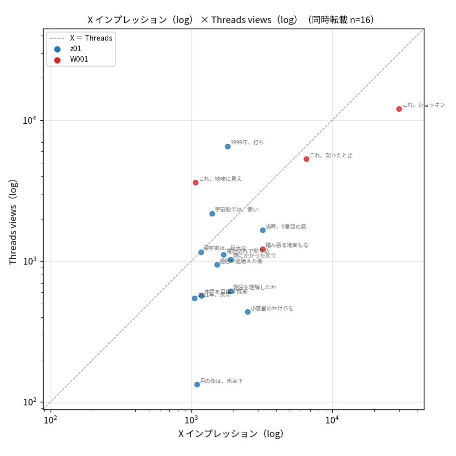
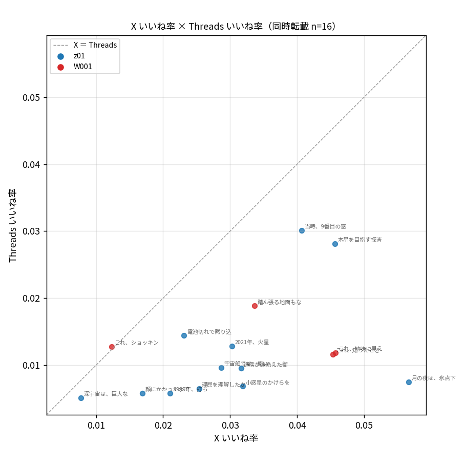

← [変更ログへ](../changelog/) ｜ [全期間の分析→](../20261025_x_threads_reaction_correlation/)

## 背景・動機

[全期間の分析](../20261025_x_threads_reaction_correlation/)で、9/24 より前は Threads 側にほぼ配信が無く（投稿あたり views 中央値 18）、全期間の相関（ρ ＝ 0.04）はその雑音で薄まっていると分かった。そこで **9/24 より前のデータを一切含めず**、Threads に配信が付いてからの投稿だけで同じ分析をやり直した。直前 8 週中央値との比も 9/24 以降の投稿だけを基準にして計算している。

## 結論

1. **X で伸びた投稿は Threads でも伸びる傾向がある。ただし弱〜中程度で、まだ確定ではない。** 同時転載 16 件で、インプ × views の Spearman ρ ＝ 0.43（p ＝ 0.10）、log10 の Pearson r ＝ 0.62。views は X インプの 0.5 倍前後（中央値 0.53）に収まり、散布図では X ＝ Threads の破線のすぐ下に帯状に並ぶ。
2. **反応の濃さ（率）は z01 で揃う。** z01 12 件のいいね率 ρ ＝ 0.64（p ＝ 0.03）、エンゲ率 ρ ＝ 0.63（p ＝ 0.03）。X でいいね率が高い短文は Threads でも高い。ただし率の水準は Threads が X の 3 分の 1（中央値 1.06% と 3.10%）。
3. **z01 の量（views）は X と連動していない。** z01 だけのインプ × views は ρ ＝ 0.28（p ＝ 0.38）。全体の ρ ＝ 0.43 を押し上げているのは W001 4 件（X 1,072〜29,875 インプと幅が広く、Threads でも順に並ぶ）。短文の到達は X のインプから予測できない。
4. **期間内でも Threads の到達は右肩上がり。** Threads 投稿日と views ÷ インプ の相関は ρ ＝ 0.47（p ＝ 0.07）。伸びなかった側の上位 3 件が 9/24〜27 に固まるのはこのため。10/1 以降の 10 件だけなら インプ × views ρ ＝ 0.58（p ＝ 0.08）で、相関は時期の立ち上がりを除くとやや強く見える。
5. 判定に必要な標本は、ρ ＝ 0.43 を p ＜ 0.05 で確かめるのに約 40 ペア。今の投稿頻度（同時転載 週 4〜5 本）で 11 月末ごろ。`python3 scripts/x_threads_corr.py --since 2026-09-24` を 1 回走らせれば同じ表が出る。

## データと方法

- 全期間の分析と同じ結合（`outputs` シートの Threads 行で X ⇄ Threads を対応付け、`X投稿一覧` と `Threads投稿一覧` から値を取る）。**Threads 投稿日が 2026-09-24 以降**のペアだけを残した：結合 30（同時転載 21、後日転載 9）
- 使用条件：X 投稿後 9 日以上、インプ ＞ 0、views ＞ 0 → 同時転載 16 件（z01 12、W001 4）。Threads 側は 10/25 取得時点の累積（経過日数 10〜31 日、中央値 22 日）
- 相関は Spearman の順位相関 ρ を主に、log10 値の Pearson r を添える。量は log10、率はそのまま
- 直前 8 週中央値との比（log2）は、基準となる同じ型の投稿が 3 件以上ある 10 件だけ

## 相関表（Spearman ρ / p / log Pearson r）

| 指標 | 同時転載（9/24 以降） | z01 | W001 | 参考：後日転載 |
|---|---|---|---|---|
| インプ vs views（log10） | n=16 ρ=0.43 p=0.099 r=0.62 | n=12 ρ=0.28 p=0.378 r=0.33 | n=4 ρ=0.80 p=0.200 r=0.69 | n=9 ρ=0.62 p=0.077 r=0.75 |
| いいね vs いいね（log10） | n=16 ρ=0.46 p=0.070 r=0.59 | n=12 ρ=-0.02 p=0.961 r=0.17 | n=4 ρ=0.80 p=0.200 r=0.70 | n=9 ρ=0.55 p=0.125 r=0.66 |
| リプライ vs リプライ | n=16 ρ=0.62 p=0.011 r=0.57 | n=12 ρ=-0.15 p=0.650 r=-0.14 | n=4 ρ=0.32 p=0.684 r=0.06 | n=9 ρ=0.32 p=0.396 r=0.39 |
| リポスト vs リポスト＋引用 | n=16 ρ=0.37 p=0.164 r=0.86 | n=12 ρ=0.03 p=0.920 r=-0.10 | n=4 ρ=0.95 p=0.051 r=0.95 | n=9 ρ=0.64 p=0.064 r=0.61 |
| エンゲ率 vs エンゲ率 | n=16 ρ=0.49 p=0.052 r=0.46 | n=12 ρ=0.63 p=0.028 r=0.55 | n=4 ρ=-0.40 p=0.600 r=-0.09 | n=9 ρ=0.35 p=0.356 r=0.15 |
| いいね率 vs いいね率 | n=16 ρ=0.46 p=0.072 r=0.40 | n=12 ρ=0.64 p=0.026 r=0.50 | n=4 ρ=-0.60 p=0.400 r=-0.17 | n=9 ρ=0.30 p=0.433 r=0.41 |
| 直前 8 週中央値との比（log2） | n=10 ρ=0.30 p=0.405 r=0.28 | n=9 ρ=0.43 p=0.244 r=0.39 | n=1 — | n=1 — |

- 全体のリプライ ρ ＝ 0.62 は、リプライが付くのが W001 に偏っていて（z01 は両媒体ともほぼ 0）、型の差を拾っている。z01 の中では −0.15
- リポストの r ＝ 0.86 は W001「これ、ショッキングな話」1 件（X 29,875 インプ）が引っ張っている。ρ ＝ 0.37 のほうを読む
- 後日転載 9 件（過去の X 投稿を Threads に転載）は ρ ＝ 0.62（p ＝ 0.08）。X で伸びた投稿を選んで転載しているので参考値

縦軸と横軸は同じ目盛り範囲。破線が X ＝ Threads。ほとんどの点が破線の少し下に帯状に並び、Threads の views は X インプの半分前後。W001「地味に見えて痺れる話」（10/02）と z01「1999年、打ち上げ直後」（10/09）だけが破線より上。

いいね率は全点が破線の下（Threads のほうが低い）。z01 は右上がりに並び、W001 は X 側で 3.4〜4.6% に固まっていて相関を取れる幅が無い。

## 中央値

| 型 | n | X インプ | Th views | views ÷ インプ | X いいね率 | Th いいね率 | X エンゲ率 | Th エンゲ率 |
|---|---|---|---|---|---|---|---|---|
| 同時転載（9/24 以降） | 16 | 1,745 | 1,136 | 0.53 | 3.10% | 1.06% | 3.54% | 1.12% |
| z01 | 12 | 1,602 | 984 | 0.53 | 2.95% | 0.85% | 3.30% | 0.85% |
| W001 | 4 | 4,880 | 4,472 | 0.61 | 3.95% | 1.23% | 5.05% | 1.37% |

## Threads で相対的に伸びた／伸びなかった投稿（log views を log インプで回帰した残差）

回帰：log10(views) ＝ 0.82 × log10(インプ) ＋ 0.39（傾き 0.82 ＜ 1：X で伸びた分ほどには Threads は伸びない）

| 向き | 投稿日 | 型 | 本文 | X インプ | Th views | 残差 |
|---|---|---|---|---|---|---|
| Threads で伸びた | 10/09 | z01 | 1999年、打ち上げ直後。ピン1本が外れて飛び… | 1,804 | 6,544 | +0.75 |
| | 10/02 | W001 | これ、地味に見えて痺れる話なんだけど聞いてほしい。 | 1,072 | 3,621 | +0.68 |
| | 09/26 | z01 | 宇宙船では、使い終えた装置は切り離すのが鉄則だ… | 1,396 | 2,182 | +0.37 |
| | 10/15 | W001 | これ、知ったとき鳥肌が立った話なんだけど聞いてほし… | 6,552 | 5,322 | +0.20 |
| | 10/11 | z01 | 深宇宙は、巨大な探査機だけの世界だと思っていた… | 1,166 | 1,163 | +0.16 |
| 伸びなかった | 09/25 | z01 | 月の夜は、氷点下170℃ほどの冷え込みが2週間も続… | 1,094 | 133 | -0.76 |
| | 09/24 | z01 | 小惑星のかけらを取りに行った探査機が、取れすぎて… | 2,510 | 437 | -0.54 |
| | 09/27 | z01 | 理屈を理解したからといって、本当に分かっているとは… | 1,893 | 613 | -0.29 |
| | 10/10 | W001 | 踏ん張る地面もない宇宙で、カメラを10分間ブレずに… | 3,208 | 1,219 | -0.18 |
| | 10/01 | z01 | 木星を目指す探査機ガリレオは1991年、大きなアン… | 1,183 | 569 | -0.16 |

伸びなかった上位 3 件は 9/24〜27 で、配信の立ち上がり途中。10 月に入ってからの残差は ±0.2 以内に収まる投稿が多く、Threads 側で突出したのは 10/09 の「1999年、打ち上げ直後」（X の 3.6 倍）と 10/02 の W001（3.4 倍）の 2 件。どちらも「1 本のピン」「地味に見えて」のように、小さな部品・地味な話から始める型。件数が少なく型の結論にはしない。

## 制約

- n ＝ 16（z01 12、W001 4）。検出できるのは |ρ| ≥ 0.6 程度。W001 の列は n ＝ 4 で読めない
- 期間内でも Threads の到達が増え続けている（フォロワー 45 → 126 人）。日付と views ÷ インプ の ρ ＝ 0.47。時期の効果を比（直前 8 週中央値）で外す方法は、基準が揃うのが 10 件だけでまだ使えない
- X は投稿後 8 日時点、Threads は累積（10〜31 日）。Threads 経過日数 × views は負（ρ ＝ −0.44。新しいほど多い）なので、累積による古い投稿の水増しは出ていない
- W001 の views は Threads 側で分割された連鎖の先頭だけ

## 変更ファイル

| ファイル | 変更内容 |
|---|---|
| `scripts/x_threads_corr.py` | `--since YYYY-MM-DD` を追加（Threads 投稿日でペアを絞り、直前 8 週中央値もその範囲内で取る。層別は 全体／z01／W001／後日転載 に切り替え） |
| `outputs/reports/x_threads_corr_since0924/` | pairs.csv・corr.md・散布図 3 枚（git 管理外） |
| `docs/scripts/index.md` | `--since` の記述 |

## 今後の課題

- **11 月末に `python3 scripts/x_threads_corr.py --since 2026-09-24 --out outputs/reports/x_threads_corr_since0924` で再計算**。40 ペア前後になれば ρ ＝ 0.4 台を判定できる
- 時期の効果を外すには、比の基準が揃う 11 月以降に「直前 8 週中央値との比」の行を読む
- z01 の量が X と連動しないのが本当なら、Threads 向けの選別は X のインプではなく率（いいね率・エンゲ率）で見るほうが筋がよい。n が増えてから確かめる
